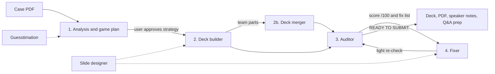

# Case Study Copilot

A pipeline of 7 Claude Agent Skills that takes a business-school case from PDF to a graded, presentation-ready PowerPoint deck. I built it with Claude to solve real university case assignments (Corvinus University of Budapest, Cases on Business Economics) and have used it for graded solo and team presentations.

About 3,800 lines of Python tooling and 45,000 words of skill instructions.

## Pipeline



| Skill | What it does |
|---|---|
| `case-study-analysis-gameplan` | Reads the case PDF once into a facts file, runs frameworks, researches precedents and the real outcome, generates strategy options (including a strategy council and wildcard ideas), debates them, and writes the agreed game plan: numbers, storyline, sources, Q&A. |
| `case-study-ppt` | Builds the .pptx from the game plan: action titles, native charts, icons, roadmaps, financials, plus PDF, speaker notes and a Q&A drill file. Shows sample slides for approval before the full build. |
| `case-slide-designer` | Turns rough content into consulting-style slides (KPI tiles, waterfalls, 2x2s, decision trees, editable maps) with a layout and rendering engine and an automated deck checker. |
| `case-deck-merger` | Merges teammates' separate slide files into one deck: one style, one storyline, one set of numbers, one sources slide. |
| `case-study-auditor` | Grades the deck like the professor (score /100, every issue with an exact fix, READY / NOT READY) and runs a live jury Q&A drill. Never edits the deck. |
| `case-study-fixer` | Applies the approved fixes, runs a light re-check, and states READY or NOT READY. At most one extra pass, so it never loops. |
| `guesstimation` | Structured market sizing and Fermi estimates with explicit assumptions, checked arithmetic and a sanity check. |

## Design decisions

- **Facts file, read once.** The case PDF is read once and turned into a facts file. Every later step works from that file, and the auditor checks it against the PDF, so numbers can't drift between steps.
- **Human in the loop.** Each step stops for approval before the next one (strategy, sample slides, fixes). Saying "just run it" switches to a no-interruption run.
- **The grader never edits.** The auditor and fixer are separate, so the score stays honest.
- **Calibration loop.** The auditor can be calibrated against real graded decks: it audits blind, compares with the real grade, and adjusts its weights once a pattern repeats.
- **Hard checks in code.** Scripts check number consistency, text overflow, copied text versus the case, slide counts against presentation length, and colour contrast.
- **Strategy rules learned from feedback.** For example, any partner deal must be shown to benefit both sides, and a final deck may never contain a slide that makes a rejected option look better.

## Install

Copy the skill folders into your Claude skills directory, or zip each folder and upload it in Claude (Settings > Capabilities > Skills). The scripts need Python 3 with `python-pptx`.

Large public data assets (Lucide icons, US map) are not stored in git. They download automatically on first use, or you can run:

```
python case-slide-designer/scripts/fetch_assets.py
```

## Credits

Icons: [Lucide](https://lucide.dev) (ISC). US map: [us-atlas](https://github.com/topojson/us-atlas) (ISC). The licences are in `case-slide-designer/assets/`.

Built by András Schrieber.
